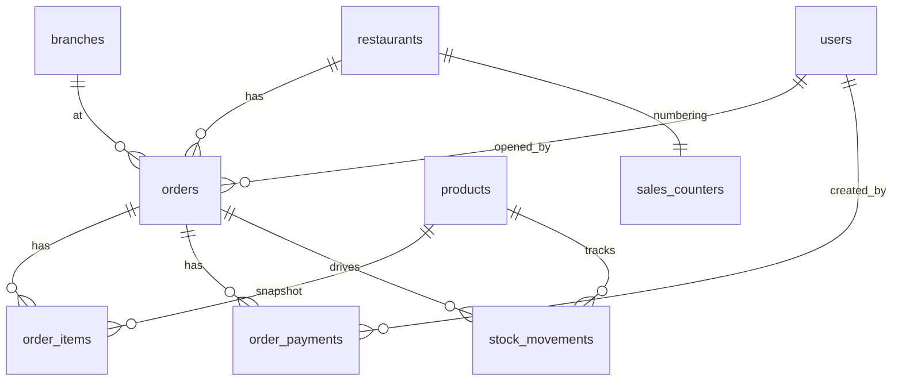

# المواصفات التقنية – MenuHub Sales Management & POS

> **الحالة:** Draft v1.0 – جاهزة للمراجعة قبل بدء التنفيذ
> **مبنية على:** `prd for pos.md` + مراجعة الكود الفعلي في `back-end/` و`front-end/`
> **نطاق هذه الوثيقة:** مواصفات فقط. لم يتم تعديل أي ملف في النظام العامل لإنتاجها.

---

## 0. كيف تُقرأ هذه الوثيقة

| القسم | المحتوى |
|---|---|
| 1 | ميثاق عدم التأثير على النظام الحالي (القيد الأهم) |
| 2 | ما اكتشفناه في الكود وكيف يغيّر تفسير الـ PRD (Gap Analysis) |
| 3 | القرارات المعمارية المعتمدة (ADR) |
| 4 | نموذج البيانات (Migrations) |
| 5 | آلة الحالات وقواعد الدفع |
| 6 | المخزون |
| 7 | الصلاحيات والأدوار والفروع |
| 8 | الاشتراكات (`pos_enabled`) |
| 9 | مواصفات API |
| 10 | التقارير والمقاييس |
| 11 | مواصفات الواجهة (Next.js) |
| 12 | الترحيل والـ Backfill |
| 13 | استراتيجية الاختبار |
| 14 | حزم العمل والإطلاق التدريجي |
| 15 | أسئلة مفتوحة تحتاج قراراً |
| ملحق | ER Diagram، أكواد الأخطاء، قائمة الملفات القديمة التي سيتم لمسها |

**ملاحظة مرجعية:** ملف `ENG.MD` يصف معمارية قديمة (Next.js + Supabase). الواقع الحالي: **Laravel modular monolith** (`back-end/modules/*`) + **Next.js كواجهة فقط** تتصل بـ Laravel API. هذه المواصفات مبنية على الكود الحالي وليس على `ENG.MD`.

---

## 1. ميثاق عدم التأثير على النظام الحالي

هذا القسم ملزم لكل مهمة تنفيذ لاحقة. أي استثناء يحتاج موافقة صريحة.

### 1.1 القواعد

| # | القاعدة |
|---|---|
| N-01 | **Additive only:** مهاجرات جديدة فقط. ممنوع `rename` أو `drop` أو تغيير نوع عمود موجود. الأعمدة الجديدة على الجداول الحالية إما `nullable` أو لها `default` آمن. |
| N-02 | **عقد QR العام لا يتغير:** `POST /api/v1/public/menus/{slug}/orders` يحتفظ بنفس الطلب والاستجابة وأكواد الأخطاء وحالة `PENDING`. |
| N-03 | **عمود `orders.status` لا تُعاد كتابة قيمه.** القيم الحالية `PENDING / CONFIRMED / REJECTED` تبقى كما هي (انظر ADR-01). |
| N-04 | **منطق `OrderService::place/confirm/reject` لا يُعدَّل** في المراحل 1–4. أي تحويله لاحقاً لاستخدام `InventoryService` يتم في حزمة مستقلة محروسة باختبارات (WP-14). |
| N-05 | **Feature flag:** كل شيء جديد مخفي خلف `config('menuhub.sales.enabled')` (env: `SALES_ENABLED`، الافتراضي `false`). |
| N-06 | **Modules جديدة معزولة:** `Sales` و`Inventory` تضاف إلى `config/modules.php` فقط عند الجاهزية، وهذا هو مفتاح الإطفاء الأصلي للنظام ("remove a name to switch the module off"). |
| N-07 | **Routes جديدة فقط** تحت `restaurants/{restaurant}/sales/*`. لا تُعاد تسمية routes الحالية. |
| N-08 | **Resources:** `OrderResource` يسمح بإضافة حقول فقط (additive). لا حذف ولا تغيير نوع حقل. |
| N-09 | **اختبارات النظام الحالي هي بوابة القبول:** كل PR يجب أن تنجح فيه جميع اختبارات `modules/*/Tests` الموجودة **دون تعديلها**. |
| N-10 | **كل migration لها `down()`** صالح، وكل backfill قابل لإعادة التشغيل (idempotent) وعلى دفعات (chunked). |
| N-11 | **لا migrations على الإنتاج بدون Backup** (متطلب PRD §17) وتجربة على نسخة من بيانات الإنتاج. |
| N-12 | **الاستثناء الوحيد المقصود في سلوك قديم** هو تصفية قائمة `GET /orders` (انظر 1.2). |

### 1.2 التعديلات الوحيدة المسموح بها على الكود القديم

بعد تفعيل قنوات جديدة سيبدأ `orders` باحتواء طلبات POS/STAFF/EXTERNAL. بدون حماية ستظهر في تبويب "طلبات المنيو" القديم. لذلك:

1. `OrderController::index`: إضافة فلتر `channel` افتراضه **`QR`** حين لا يُرسل المعامل. النتيجة للواجهة الحالية: نفس البيانات تماماً.
2. `OrderResource`: إضافة حقول جديدة (additive).
3. ملفات Auth/Plan/Roles (أدوار جديدة، `pos_enabled`): تغييرات إضافية فقط – القائمة الكاملة في الملحق ج.

### 1.3 مراحل الإطلاق (كل مرحلة قابلة للرجوع عنها)

| المرحلة | ما يحدث | أثر على الإنتاج | الرجوع |
|---|---|---|---|
| S0 | هذه المواصفات فقط | لا شيء | – |
| S1 | Migrations الإضافية + Backfill (dark) | أعمدة جديدة غير مستخدمة | `migrate:rollback` |
| S2 | Backend للـ Sales خلف الـ flag (مغلق) | لا شيء مرئي | `SALES_ENABLED=false` |
| S3 | الواجهات + ربط الخطة | تظهر فقط لمن `pos_enabled` + permission | إخفاء بالـ flag |
| S4 | Pilot لمنشأة أو اثنتين | محدود | إيقاف الخطة للمنشأة |
| S5 | GA | الجميع على Business | – |

---

## 2. ما اكتشفناه في الكود الحالي (Gap Analysis)

هذه الفروقات بين افتراضات الـ PRD والواقع، وكل بند له قرار في الأقسام اللاحقة.

| # | الـ PRD يفترض | الواقع في الكود | القرار |
|---|---|---|---|
| G-01 | حالات التنفيذ `OPEN/CONFIRMED/CANCELLED/REJECTED` | `orders.status` = `PENDING/CONFIRMED/REJECTED` (`OrderStatus` enum) والواجهة الحالية تعتمد عليها | ADR-01: لا نغيّر المخزَّن؛ `OPEN` اسم API لـ `PENDING`؛ نضيف `CANCELLED` فقط |
| G-02 | حقل `order_type` | موجود `delivery_type` بقيم `delivery / dine_in / pickup` (lowercase) | ADR-02: إعادة استخدام `delivery_type` مع Mapping |
| G-03 | `branch_id` + `branch_name_snapshot` | `branch_name` نص حر موجود، لا `branch_id` | إضافة `branch_id`، و`branch_name` يؤدي دور الـ snapshot |
| G-04 | الأدوار `CASHIER/WAITER` | `RestaurantRole` = `OWNER/MANAGER/EDITOR`؛ عمود `restaurant_users.role` نصي (20) → يتسع | إضافة cases جديدة، لا تغيير schema |
| G-05 | `PlanLimiter::assertFeature('pos')` | التوقيع الفعلي `assertFeature(string $restaurantId, string $feature)`. و`match` فيه **يتجاهل أي ميزة غير معروفة (fail-open)** | إضافة `'pos' => 'pos_enabled'`، وسلوك fail-closed للـ POS (القسم 8) |
| G-06 | سجل حركة مخزون | فقط `products.stock_quantity` (`NULL` = غير متتبع). لا يوجد سجل | جدول `stock_movements` جديد |
| G-07 | تكلفة المنتج وقت البيع | لا يوجد `cost_price` على `products` ولا `cost_snapshot` على `order_items` | أعمدة جديدة (المرحلة 5) |
| G-08 | "كل منتج له سعر صالح" | `products.price` و`order_items.unit_price/line_total` أصبحت **nullable** (منتجات بلا سعر مسموحة في QR) | قواعد خاصة (5.6) |
| G-09 | رقم فاتورة | `number` عشوائي `MH-XXXXXX` | عدّاد تسلسلي للقنوات الجديدة (4.5) |
| G-10 | عملة المنشأة | `orders.currency` تؤخذ من **أول بند**، و`products.currency` خاصة بكل منتج | منع خلط العملات في الـ Sales (9.4) |
| G-11 | Row Locking | `OrderService::confirm` يقفل المنتجات بترتيب البنود (خطر Deadlock) | `InventoryService` يرتب المعرّفات قبل القفل |
| G-12 | اختبارات التزامن | اختبارات المشروع على SQLite in-memory، حيث `lockForUpdate` **لا يعمل** | اختبارات التزامن على MySQL (القسم 13) |
| G-13 | "المدفوعات" كقسم في لوحة الإدارة | جدول `payments` و`invoices` موجودان أصلاً لفوترة اشتراكات المنصة | أسماء جديدة: `order_payments`، والفاتورة = `orders`. لا تُستخدم كلمة `invoices` كجدول |
| G-14 | تقارير بتوقيت المنشأة | `restaurants.timezone` موجود (افتراضي `Asia/Damascus`) و`app.timezone=UTC` | الحدود تحسب في PHP (القسم 10.2) |
| G-15 | قاعدة البيانات "حسب البنية الحالية" | الإنتاج MySQL (`.env.example`) | كل DDL والاستعلامات متوافقة مع MySQL 8 وSQLite للاختبار |
| G-16 | ملاحظات على البند/الطلب | لا `note` على `order_items` ولا `notes` على `orders`. `extra` موجود دائماً 0 | إضافة `note` و`notes` |
| G-17 | تقرير الأقسام | `order_items` لا يحفظ القسم؛ الربط الحي عبر `product→category` يتغيّر لو نُقل المنتج | snapshot للقسم على البند |
| G-18 | "منع الفواتير القديمة من التعديل" | `Order` model لا يمنع التعديل | قواعد immutability (5.5) |

---

## 3. القرارات المعمارية (ADR)

### ADR-01: حالة التنفيذ
- **القرار:** `orders.status` هو حالة التنفيذ. لا يُضاف عمود `fulfillment_status` مكرر.
- التخزين: `PENDING`، `CONFIRMED`، `REJECTED`، + قيمة جديدة `CANCELLED`.
- طبقة API تعرض الحقل `fulfillment_status` بقيم PRD عبر Accessor: `PENDING→OPEN`.
- **السبب:** لا Backfill، لا خطر على QR الحالي، لا ازدواج مصدر الحقيقة.
- **أثر `CANCELLED`:** تُضاف إلى `OrderStatus` enum. الواجهة القديمة لا تعرضها إلا إن طُلبت صراحة. يُحدَّث نوع `OrderStatus` في `front-end/src/modules/orders/types.ts` بشكل إضافي.
- **مسودات (Drafts):** لا مسودات على الخادم في الإصدار 1. السلة تعيش في الواجهة، والطلب يُنشأ مثبتاً مباشرة. لذلك `OPEN` ≡ `PENDING` ≡ طلبات QR بانتظار التأكيد فقط، ولا يوجد خطر ظهور مسودة POS في قائمة QR أو إمكانية تأكيدها بالـ endpoint القديم.

### ADR-02: نوع الطلب
- نعيد استخدام `orders.delivery_type`. Mapping في طبقة API:

| `delivery_type` (مخزَّن) | `order_type` (API) |
|---|---|
| `dine_in` | `DINE_IN` |
| `pickup` | `TAKEAWAY` |
| `delivery` | `DELIVERY` |

### ADR-03: بنية الـ Modules

| Module | الحالة | المسؤولية |
|---|---|---|
| `Orders` | موجود | الـ migration الإضافي لأعمدة دفتر المبيعات، تحديث Models/Resources. لا منطق جديد |
| `Sales` | **جديد** | إنشاء المبيعات (POS/STAFF/EXTERNAL)، الدفعات، الاسترداد، الإلغاء، الفواتير، التقارير |
| `Inventory` | **جديد** | `InventoryService` (خصم/إرجاع)، `stock_movements` |

`Sales` يعتمد على `Orders`/`Catalog` عبر Models العامة فقط (قاعدة المشروع في `config/modules.php`)، ويعتمد على الخطط عبر `EnforcesPlanLimits` contract.

### ADR-04: مصدر واحد للحقيقة المالية
- `order_payments` هو **المصدر الوحيد** للتحصيل والاسترداد.
- `orders.paid_amount` و`refunded_amount` و`payment_status` هي **أعمدة مخزَّنة مشتقة (cache)** تُحدَّث فقط داخل `PaymentService` في نفس الـ transaction. ويوجد أمر تدقيق `sales:reconcile` يكتشف أي انحراف.

### ADR-05: عدم إعادة فتح الرصيد بعد الاسترداد الجزئي
- `balance_due = max(0, total − paid_amount)` (الاسترداد لا يعيد فتح الرصيد).
- مثال: فاتورة 100 مدفوعة بالكامل ثم استرداد 20 → `payment_status = PAID`، `refunded_amount = 20`، `balance_due = 0`.
- `REFUNDED` فقط حين `refunded_amount == paid_amount && paid_amount > 0`.

### ADR-06: الطلبات القديمة (Legacy)
- نضيف `orders.is_legacy` (boolean). تُضبط `true` لكل الصفوف الموجودة وقت الترحيل.
- لا نفترض أن الطلب القديم مدفوع ولا غير مدفوع فعلياً (لا معلومة). `payment_status = UNPAID` شكلياً، لكن:
  - تدخل في **المبيعات** وتوزيع القنوات (القناة `QR`).
  - **لا تدخل** في "غير المحصل" ولا في التحصيلات.
  - تظهر في الفواتير بشارة "قديم – بدون بيانات دفع".
  - يمكن تحصيلها لاحقاً من المدير إن أراد (تسجَّل COLLECTION حقيقية).

### ADR-07: لا Idempotency عامة، بل مفاتيح على كل عملية مالية
- `orders.client_request_id` و`order_payments.client_request_id` مع unique index. تفاصيل 9.5.

### ADR-08: الأموال
- لا `float` في أي مقارنة مالية جديدة (الكود الحالي يستخدم `round((float)…)`). نستخدم `bcmath` أو `Brick\Math` (يتأكد وجودها في `composer.json` وقت التنفيذ) ونقارن نصوصاً عشرية بدقة 2.

---

## 4. نموذج البيانات

كل الأسماء بنمط المشروع: UUID PK (`BaseModel`)، `varchar` بدل `ENUM`، تواريخ UTC.
تاريخ أسماء الملفات: `2026_11_12_*` فما بعد (آخر migration حالي `2026_11_11_000240`).

### 4.1 تعديل `orders` (Module: Orders) — إضافي بالكامل

| العمود | النوع | Default / Null | ملاحظة |
|---|---|---|---|
| `channel` | varchar(20) | NOT NULL default `'QR'` | القيمة الافتراضية = Backfill تلقائي لكل الطلبات القديمة (كلها من المنيو) |
| `payment_status` | varchar(20) | NOT NULL default `'UNPAID'` | `UNPAID/PARTIAL/PAID/REFUNDED` |
| `is_legacy` | boolean | NOT NULL default `false` | يُضبط true للصفوف الموجودة (12.2) |
| `opened_by` | uuid FK users | nullable, `nullOnDelete` | |
| `cashier_id` | uuid FK users | nullable | آخر من حصّل (للعرض). المرجع الحقيقي `order_payments.created_by` |
| `confirmed_by` | uuid FK users | nullable | |
| `branch_id` | uuid FK branches | nullable, `nullOnDelete` | |
| `subtotal` | decimal(12,2) | NOT NULL default 0 | قبل الخصم |
| `discount_total` | decimal(12,2) | NOT NULL default 0 | |
| `discount_approved_by` | uuid FK users | nullable | |
| `discount_note` | varchar(255) | nullable | |
| `paid_amount` | decimal(12,2) | NOT NULL default 0 | مشتق (ADR-04) |
| `refunded_amount` | decimal(12,2) | NOT NULL default 0 | مشتق |
| `paid_at` | timestamp | nullable | وقت اكتمال الدفع |
| `cancelled_at` | timestamp | nullable | |
| `cancelled_by` | uuid FK users | nullable | |
| `cancel_reason` | varchar(500) | nullable | |
| `notes` | text | nullable | ملاحظات عامة |
| `inventory_deducted_at` | timestamp | nullable | حارس منع الخصم المكرر |
| `inventory_restored_at` | timestamp | nullable | حارس منع الإرجاع المكرر |
| `client_request_id` | char(36) | nullable | Idempotency للإنشاء |
| `request_hash` | char(64) | nullable | hash الحمولة لكشف إعادة استخدام المفتاح بحمولة مختلفة (9.5) |
| `confirmed_at` | – | **موجود** | يُعاد استخدامه. `total` و`currency` و`branch_name` و`table_number` موجودة |

**Constraints / Indexes:**

```
UNIQUE (restaurant_id, client_request_id)
INDEX  (restaurant_id, channel, status, confirmed_at)
INDEX  (restaurant_id, payment_status, status)
INDEX  (restaurant_id, branch_id, confirmed_at)
INDEX  (restaurant_id, opened_by, confirmed_at)
INDEX  (restaurant_id, confirmed_at)
```

> MySQL 8: الإضافات بقيم default ثابتة تتم بـ `ALGORITHM=INSTANT`؛ تأكد وقت التنفيذ على نسخة الإنتاج، وبخلاف ذلك جدولة النافذة الزمنية.

Backfill داخل نفس migration (بدون حاجة لأمر): `UPDATE orders SET subtotal = total` (chunked) لأن `subtotal` الافتراضي 0 غير صحيح للقديم.

### 4.2 تعديل `order_items`

| العمود | النوع | ملاحظة |
|---|---|---|
| `discount_total` | decimal(12,2) default 0 | خصم البند |
| `line_net` | decimal(12,2) nullable | الصافي بعد خصم البند وحصته من خصم الطلب. يُحسب مرة واحدة عند التثبيت (10.3) |
| `note` | varchar(500) nullable | ملاحظة البند |
| `category_id_snapshot` | uuid nullable | بدون FK (لقطة) |
| `category_name_snapshot` | varchar(200) nullable | |
| `cost_snapshot` | decimal(12,2) nullable | تكلفة **الوحدة** وقت البيع (المرحلة 5) |

`name_ar` و`unit_price` و`quantity` و`line_total` موجودة وتؤدي دور لقطة البند التاريخية. Backfill للقديم: `line_net = line_total`، وللقسم من الربط الحي بأمر منفصل best-effort (12.3).

### 4.3 جدول جديد `order_payments` (Module: Sales)

```sql
id                  uuid PK
restaurant_id       uuid FK restaurants (cascade)   -- للعزل وسرعة التقارير
order_id            uuid FK orders (RESTRICT)       -- ممنوع حذف فاتورة لها دفعات
type                varchar(12)                     -- COLLECTION | REFUND
method              varchar(10)                     -- CASH | CARD | OTHER
amount              decimal(12,2)                   -- دائماً > 0 (النوع يحدد الاتجاه)
tendered_amount     decimal(12,2) null              -- المستلم نقداً (COLLECTION/CASH)
change_amount       decimal(12,2) null              -- الباقي للزبون
reason              varchar(255) null               -- سبب الاسترداد
notes               varchar(500) null
reference           varchar(100) null
refund_of_id        uuid null                       -- إشارة اختيارية للتحصيل الأصلي
created_by          uuid FK users
branch_id           uuid null
client_request_id   char(36) null
request_hash        char(64) null
created_at          timestamp                       -- لا updated_at

UNIQUE (restaurant_id, client_request_id)
INDEX  (order_id)
INDEX  (restaurant_id, type, created_at)
INDEX  (restaurant_id, created_by, created_at)
INDEX  (restaurant_id, method, created_at)
```

### 4.4 جدول جديد `stock_movements` (Module: Inventory)

```sql
id              uuid PK
restaurant_id   uuid FK
product_id      uuid FK products (cascade? -> nullOnDelete + name snapshot)
product_name    varchar(200)                  -- snapshot
order_id        uuid FK orders (RESTRICT) null
reason          varchar(20)                   -- SALE | CANCEL_RETURN | ADJUSTMENT(future)
quantity_delta  int                           -- سالب للبيع، موجب للإرجاع
stock_before    int
stock_after     int
created_by      uuid null
created_at      timestamp

UNIQUE (order_id, product_id, reason)   -- حماية DB ضد التكرار
INDEX  (restaurant_id, product_id, created_at)
```

المنتجات غير المتتبعة (`stock_quantity IS NULL`) **لا تُسجَّل لها حركة**.

### 4.5 جدول جديد `sales_counters` (Module: Sales)

```sql
restaurant_id  uuid PK FK
last_number    unsigned bigint
```
- عند التثبيت: قفل الصف (`lockForUpdate`) وزيادة العدّاد.
- `orders.number` للقنوات الجديدة = `S-000123` (عرض 6 خانات، يتوسع تلقائياً). تبقى `UNIQUE(restaurant_id, number)` الحالية كما هي.
- QR القديم يحتفظ بـ `MH-XXXXXX`.

### 4.6 تعديلات صغيرة أخرى

| الجدول | التعديل | سبب |
|---|---|---|
| `plans` | `pos_enabled` boolean default false | القسم 8 |
| `restaurant_users` | `branch_id` uuid nullable FK `branches` | عزل الفروع للكاشير/النادل (null = كل الفروع) |
| `products` | `cost_price` decimal(12,2) nullable | المرحلة 5 |

### 4.7 ER مختصر



---

## 5. آلة الحالات وقواعد الدفع

### 5.1 حالات التنفيذ (مخزَّنة في `orders.status`)

```
PENDING(OPEN) ──confirm──▶ CONFIRMED ──cancel──▶ CANCELLED
      │
      └────reject────▶ REJECTED
```

| الانتقال | من | إلى | المنفّذ | شرط | أثر مخزني |
|---|---|---|---|---|---|
| إنشاء بيع POS/STAFF/EXTERNAL | – | CONFIRMED | حسب القناة | سلة صالحة | خصم المخزون |
| تأكيد QR (قائم) | PENDING | CONFIRMED | `orders.manage` | – | خصم (المنطق القديم) |
| رفض QR (قائم) | PENDING | REJECTED | `orders.manage` | – | لا شيء |
| إلغاء | CONFIRMED | CANCELLED | `sales.cancel` | انظر 5.4 | إرجاع المخزون مرة واحدة |

أي انتقال آخر → `422 INVALID_TRANSITION`.

### 5.2 حالات الدفع (مشتقة)

بعد كل عملية في `order_payments` يُعاد الحساب من المجاميع، تحت قفل صف الطلب:

```
paid      = SUM(amount WHERE type=COLLECTION)
refunded  = SUM(amount WHERE type=REFUND)

if paid == 0                              → UNPAID
elif refunded == paid                     → REFUNDED
elif paid >= total                        → PAID     (+ paid_at إن كانت أول مرة)
else                                      → PARTIAL
```

### 5.3 قواعد التحصيل والاسترداد

| # | القاعدة | خطأ |
|---|---|---|
| P-01 | يُسمح بالتحصيل فقط على `CONFIRMED` | `ORDER_NOT_COLLECTABLE` |
| P-02 | `amount ≤ total − paid_amount` | `OVERPAYMENT` |
| P-03 | `amount ≤ paid_amount − refunded_amount` للاسترداد | `REFUND_EXCEEDS_PAID` |
| P-04 | `amount > 0` ولا تعديل/حذف أي صف | `IMMUTABLE_RECORD` (على مستوى Model) |
| P-05 | نقداً: `tendered ≥ amount` و`change = tendered − amount` | 422 |
| P-06 | الطلب الذي فيه بند بلا سعر (G-08) لا يُحصَّل حتى يُسعَّر (5.6) | `ORDER_HAS_UNPRICED_ITEMS` |
| P-07 | كل العمليات داخل `DB::transaction` مع `lockForUpdate` على الطلب | – |
| P-08 | `client_request_id` مكرر → إعادة نفس النتيجة (9.5) | – |

### 5.4 الإلغاء

شروط (للمالك/المدير فقط):
1. الحالة `CONFIRMED` وغير `CANCELLED`.
2. `cancel_reason` إلزامي (3–500 حرف).
3. إن كان `paid_amount − refunded_amount > 0`: يجب أن يتضمن الطلب `refund: { method }` ليتم **استرداد الرصيد الصافي كاملاً في نفس الـ transaction** قبل الإلغاء. وإلا `422 REFUND_REQUIRED_BEFORE_CANCEL` (AC-05).
4. إرجاع المخزون مرة واحدة: يعتمد على `inventory_restored_at IS NULL` + unique index على `stock_movements`.
5. لا حذف فعلي (PRD §10.3).

### 5.5 عدم قابلية التعديل (Immutability)

- `OrderPayment` و`StockMovement`: `updating`/`deleting` في الـ model ترمي استثناءً. لا `updated_at`.
- أصناف الفاتورة بعد التثبيت (`CONFIRMED`): لا تعديل على `order_items` (الكمية/السعر/الاسم) من أي endpoint. التصحيح = إلغاء ثم فاتورة جديدة.
- كل العمليات الحساسة تُسجَّل عبر آلية Audit الحالية (`Auditable` + `ActivityRecorded`) مع إضافة تسميات في `AuditLabels`.

### 5.6 البنود بلا سعر (G-08)

QR الحالي يسمح بمنتج بلا سعر (`unit_price/line_total = NULL`).
- **POS/STAFF/EXTERNAL:** يُرفض المنتج بلا سعر (`PRODUCT_NOT_SELLABLE`) — PRD §6.4.
- **طلب QR فيه بند بلا سعر:** يُعرض `requires_pricing = true` في الـ API. التحصيل عليه ممنوع (P-06). المدير يسعّر قبل ذلك بـ endpoint `POST orders/{id}/price-items` (سؤال مفتوح Q-06؛ البديل: يُستبعد من التقارير المالية ويُعرض بشارة).
- في التقارير: الطلبات التي فيها بنود بلا سعر تُحسب بإجمالي `total` المخزَّن، وتُعرض بعدّاد منفصل "طلبات تحتاج تسعير".

### 5.7 الخصومات

- الصلاحية `sales.discount` (مالك/مدير). لدى الآخرين → `403 DISCOUNT_NOT_ALLOWED` إن أُرسل أي خصم.
- يقبل الطلب `discount: { type: "FIXED"|"PERCENT", value }` على مستوى الطلب (وخصم بند اختياري). يُحوَّل دائماً إلى مبلغ ثابت مخزَّن.
- `0 ≤ discount_total ≤ subtotal` (لا إجمالي سالب → `INVALID_DISCOUNT`).
- يُحفظ `discount_approved_by` = المنفّذ، وسبب اختياري.
- توزيع خصم الطلب على البنود تناسبياً لحساب `line_net` (الفرق الصغير ينتقل لآخر بند).

---

## 6. المخزون

### 6.1 الخدمة المشتركة `InventoryService` (Module: Inventory)

```php
deduct(Order $order, ?string $userId): void   // idempotent
restore(Order $order, ?string $userId): void  // idempotent
```

**خوارزمية `deduct` (داخل transaction يملكها المستدعي):**
1. اقفل صف الطلب. إن كان `inventory_deducted_at` غير null → `return` (لا شيء).
2. اجمع الكميات حسب `product_id`، **رتّب المعرفات تصاعدياً** (منع Deadlock، G-11).
3. اقفل المنتجات `lockForUpdate` بهذا الترتيب.
4. تحقق: المنتج موجود ويتبع المنشأة وحالته `AVAILABLE` (إلا إن كان الخصم لطلب مثبَّت سابقاً) وكمية كافية إن كان `stock_quantity` غير null → وإلا `422 INSUFFICIENT_STOCK` (مع `product_id` والمتاح).
5. اخصم، وسجّل `stock_movements` للمتتبعة، واضبط `inventory_deducted_at`.

`restore`: نفس الفكرة بعكس الإشارة، حارسها `inventory_restored_at`، ويشترط `inventory_deducted_at` غير null.

### 6.2 التوافق مع الطلبات القديمة

- `OrderService::confirm` القديم يخصم المخزون لكنه لا يضبط `inventory_deducted_at` ولا يسجل حركات.
- **Backfill (12.2):** `inventory_deducted_at = confirmed_at` لكل طلب قديم `CONFIRMED`، حتى لا يخصم النظام الجديد ثانية، ويمكن إرجاعه عند الإلغاء.
- **حتى تنفيذ WP-14:** أي تأكيد QR جديد عبر المسار القديم لن يضبط الحارس. لذلك يضاف في WP-14 سطر واحد فقط لضبط `inventory_deducted_at` (أو تحويل المسار بالكامل لـ `InventoryService`). **هذا يجب أن يسبق** تفعيل الإلغاء على طلبات QR. حتى ذلك الحين: الإلغاء متاح فقط للطلبات التي `inventory_deducted_at` فيها غير null أو غير متتبعة (وإلا `CANCEL_NOT_SUPPORTED_YET`).

### 6.3 قواعد البيع في الواجهة والخادم

المنتج قابل للإضافة للسلة فقط إذا (يُتحقق منها في الخادم دائماً):
- `status = AVAILABLE`.
- قسمه `is_active = true` ويتبع المنشأة.
- `price IS NOT NULL` و> 0 (يُسأل Q-05 هل يُسمح بصفر).
- `stock_quantity IS NULL` أو `≥` الكمية المطلوبة.
- عملة المنتج = عملة المنشأة (9.4).

لا اشتراط أن يكون المنيو منشوراً للـ POS (السؤال Q-04).
لا تغيير تلقائي لـ `status` عند نفاد المخزون (سلوك الكود الحالي، ويؤكده `OrderTest`). الواجهة تعرض "نفذت" عندما `stock_quantity = 0`.

---

## 7. الصلاحيات والأدوار والفروع

### 7.1 الأدوار

إضافة `Cashier = 'CASHIER'` و`Waiter = 'WAITER'` إلى `RestaurantRole`. عمود `role` نصي (20) فلا تغيير schema.

### 7.2 صلاحيات جديدة (في `Permissions.php` ومرآتها `permissions.ts`)

| الصلاحية | الوصف |
|---|---|
| `pos.use` | عرض شاشة POS |
| `sales.view` | عرض الفواتير |
| `sales.create` | إنشاء بيع (POS/EXTERNAL) |
| `sales.create_staff` | إنشاء طلب نادل (قناة STAFF فقط) |
| `sales.collect` | تحصيل |
| `sales.discount` | خصم مفتوح |
| `sales.cancel` | إلغاء |
| `sales.refund` | استرداد |
| `reports.sales` | التقارير الكاملة |
| `reports.own` | حصيلة الكاشير الخاصة |

### 7.3 المصفوفة (تطابق PRD §13.2)

| الصلاحية | OWNER | MANAGER | CASHIER | WAITER | EDITOR |
|---|:-:|:-:|:-:|:-:|:-:|
| `pos.use` | ✔ | ✔ | ✔ | – | – |
| `sales.view` | ✔ | ✔ | ✔ | – | – |
| `sales.create` | ✔ | ✔ | ✔ | – | – |
| `sales.create_staff` | ✔ | ✔ | ✔ | ✔ | – |
| `sales.collect` | ✔ | ✔ | ✔ | – | – |
| `sales.discount` | ✔ | ✔ | – | – | – |
| `sales.cancel` | ✔ | ✔ | – | – | – |
| `sales.refund` | ✔ | ✔ | – | – | – |
| `reports.sales` | ✔ | ✔ | – | – | – |
| `reports.own` | ✔ | ✔ | ✔ | – | – |
| `orders.view` / `orders.manage` (QR الحالية) | كما هي | كما هي | `view` فقط (Q-07) | – | – |

الصلاحيات الحالية للمالك/المدير/المحرر **لا تتغير**. المالك يرث `ALL`، فيجب إضافة الجديدة إلى `Permissions::ALL`. المدير تُضاف له يدوياً (حسب الجدول).

### 7.4 نطاق الفروع

- `restaurant_users.branch_id` (null = كل الفروع).
- إن كان لدى المستخدم `branch_id`: كل الاستعلامات (الفواتير، التقارير، الإنشاء) تُقيَّد بفرعه، وإنشاء بيع لفرع آخر → `403 BRANCH_FORBIDDEN`.
- `branch_id` في الطلب يجب أن يتبع المنشأة (`restaurant_id`) — تحقق صريح.

### 7.5 أثر إضافة الأدوار على الكود الحالي (نقاط يجب فحصها وقت التنفيذ)

| الموضع | المطلوب |
|---|---|
| `StaffController::ASSIGNABLE` | إضافة `CASHIER`, `WAITER` (التحقق، لا تغيير للقديم) |
| `PlanLimiter::usage(STAFF)` | يعدّ الأدوار الجديدة ضمن `max_staff` (سلوك مقبول؛ Pro = 5) |
| `front-end/.../tenancy/types.ts` `RestaurantRole` | إضافة الأدوار |
| `front-end/.../core/lib/labels.ts` `RESTAURANT_ROLE_LABELS` | `CASHIER: "كاشير"`, `WAITER: "نادل"` |
| `staff-role-select/form/permissions` | عرض الأدوار الجديدة |
| `dashboard/layout.tsx` ومنطق ما بعد الدخول | الكاشير/النادل لا يملكون صلاحيات لوحة الإدارة؛ يجب ألا ينهار التخطيط، ويُحوَّلون: CASHIER→`/pos`، WAITER→`/waiter` |
| `ResolveTenant` | لا تغيير (يقرأ `membership->role` عبر enum) |

---

## 8. الاشتراكات – `pos_enabled`

### 8.1 تغييرات Backend

| الملف | التغيير |
|---|---|
| Migration جديدة (Billing) | `plans.pos_enabled` boolean default false؛ ثم `UPDATE plans SET pos_enabled=1 WHERE slug='business'` |
| `Plan` model | إضافة للـ casts/fillable حسب الموجود |
| `PlanSeeder` | `pos_enabled` لكل خطة (business=true، الباقي false) |
| `PlanController` / Admin | قبول `pos_enabled` في التحقق والإرجاع (إضافي) |
| `PlanLimiter::assertFeature` | `'pos' => 'pos_enabled'` في الـ `match` |
| `PlanLimiter::summary` | `features.pos` (إضافي) |
| `EnforcesPlanLimits` | ثابت `FEATURE_POS = 'pos'` (إضافي) |
| Middleware جديد `feature:{name}` (Billing) | يستدعي `assertFeature(tenant->restaurant->id, name)` |

### 8.2 سلوك الأمان (مهم)

الكود الحالي يترك الميزة مفتوحة (fail-open) حين: لا توجد خطة، أو `ENFORCE_PLAN_LIMITS=false`، أو ميزة غير معروفة. بالنسبة للـ POS (ميزة مالية):
- ميزة `pos` غير المعروفة **لا تُمرَّر** أبداً (تُضاف للـ match).
- إن لم تُحدَّد خطة: `planOf` يرجع خطة `free` وهي غير فعّالة للـ POS → رفض.
- `ENFORCE_PLAN_LIMITS=false` يعني POS مفتوح للجميع: مقبول في التطوير فقط، ويُوثَّق كشرط إنتاج (`true`). والـ flag `SALES_ENABLED` يبقى سياجاً ثانياً.

الخطأ: HTTP 403، `code = PLAN_FEATURE_UNAVAILABLE` (مطابق للـ PRD).

> توقيع الـ PRD `PlanLimiter::assertFeature('pos')` يُنفَّذ فعلياً كـ `assertFeature($restaurantId, 'pos')`.

### 8.3 ما يخضع للبوابة وما لا يخضع

| المسار | بوابة `pos` |
|---|---|
| `sales/*` (كل ما هو جديد) | **نعم** |
| `/pos` و`/waiter` و`/dashboard/sales*` | **نعم** |
| طلبات QR العامة (`public/menus/{slug}/orders`) | **لا** |
| `orders` القديمة (عرض/تأكيد/رفض) | **لا** (تستمر حسب `orders.*`) |

### 8.4 سلوك الـ Downgrade
عند فقدان المنشأة للميزة: تُرفض `sales/*` بـ 403. البيانات تبقى محفوظة، وQR يستمر. (Q-08: هل يُسمح بعرض/تصدير السجل للقراءة فقط بعد الـ downgrade؟ الافتراضي: لا.)

---

## 9. مواصفات API

**الأساس:** `/api/v1/restaurants/{restaurant}/sales/...`
**Middleware:** `auth:sanctum`, `active`, `tenant`, `tenant.active`, `feature:pos`, `permission:<x>` (نفس سلسلة `Orders/Routes/api.php`).
**الصيغة:** نفس غلاف `ApiController` (`data`, `message`, `code`, `errors`). نفس ترقيم الصفحات (`perPage`). الصفحات في الفواتير **Pagination إلزامي**.

### 9.1 جدول الـ Endpoints

| Method | Path | Permission | الغرض |
|---|---|---|---|
| GET | `sales/catalog` | `pos.use` أو `sales.create_staff` | منتجات/أقسام مخففة للبيع |
| POST | `sales/orders` | `sales.create` (POS/EXTERNAL) أو `sales.create_staff` (STAFF) | إنشاء بيع مثبَّت (+ دفعة اختيارية) |
| GET | `sales/orders` | `sales.view` | قائمة الفواتير + فلاتر |
| GET | `sales/orders/{order}` | `sales.view` | تفاصيل + بنود + دفعات + سجل |
| GET | `sales/orders/unpaid` | `sales.collect` | الفواتير المستحقة للكاشير |
| POST | `sales/orders/{order}/payments` | `sales.collect` | تحصيل |
| POST | `sales/orders/{order}/refunds` | `sales.refund` | استرداد |
| POST | `sales/orders/{order}/cancel` | `sales.cancel` | إلغاء |
| GET | `sales/orders/{order}/receipt` | `sales.view` | بيانات الإيصال |
| GET | `sales/reports/summary` | `reports.sales` | المؤشرات الرئيسية |
| GET | `sales/reports/timeseries` | `reports.sales` | سلسلة زمنية (ساعة/يوم) |
| GET | `sales/reports/channels` | `reports.sales` | توزيع القنوات |
| GET | `sales/reports/payment-methods` | `reports.sales` | توزيع طرق الدفع |
| GET | `sales/reports/products` | `reports.sales` | منتجات |
| GET | `sales/reports/categories` | `reports.sales` | أقسام |
| GET | `sales/reports/staff` | `reports.sales` (والكاشير: `reports.own`) | موظفون |
| GET | `sales/reports/branches` | `reports.sales` | فروع |
| GET | `sales/reports/profitability` | `reports.sales` | هامش (المرحلة 5) |
| GET | `sales/me/collections` | `reports.own` | حصيلة المستخدم |

**القناة تُحدَّد في الخادم، لا يثق بها العميل:**
- `/waiter` → تُرسل `channel: "STAFF"`، ويرفض الخادم أي قيمة أخرى لمن يملك `sales.create_staff` فقط.
- `POS`/`EXTERNAL` تتطلب `sales.create`.
- `QR` ممنوعة من هذا الـ endpoint.

### 9.2 إنشاء بيع `POST sales/orders`

Header: `Idempotency-Key: <uuid>` (إلزامي)

```json
{
  "channel": "POS",
  "order_type": "DINE_IN",
  "table_number": "7",
  "branch_id": "uuid|null",
  "notes": "string|null",
  "items": [
    { "product_id": "uuid", "quantity": 2, "note": "بدون بصل", "discount": null }
  ],
  "discount": { "type": "PERCENT", "value": 10, "note": "عميل دائم" },
  "payment": {
    "method": "CASH",
    "amount": 45000,
    "tendered_amount": 50000,
    "reference": null
  }
}
```

قواعد:
- الأسعار والأسماء **تُقرأ من DB** (لا تُقبل من العميل).
- `payment` اختياري: بدونه → `CONFIRMED + UNPAID` (نادل/طلب خارجي). معه ومساوٍ للإجمالي → `PAID` في نفس الـ transaction (AC-02). أقل من الإجمالي → `PARTIAL`. أكبر → `OVERPAYMENT`.
- `channel=STAFF` + `payment` أو `discount` → `403`.
- `table_number` مطلوب لـ `DINE_IN` (نص، ≤ 50).
- `items`: 1–100 بند، كمية 1–9999، دمج تلقائي للمكرر.
- `address` مطلوب لـ `DELIVERY` (حقل موجود).

التسلسل داخل `DB::transaction`:

```
1. فحص idempotency (client_request_id) → إن وُجد، أعد النتيجة
2. جلب المنتجات + التحقق من قابلية البيع + العملة
3. حساب subtotal / discount / line_net / total (decimal آمن)
4. إنشاء الطلب (status=CONFIRMED, confirmed_at, confirmed_by, number من sales_counters)
5. إنشاء البنود مع اللقطات (اسم، سعر، قسم، تكلفة إن وُجدت)
6. InventoryService::deduct
7. (إن وُجدت دفعة) PaymentService::collect
8. Audit event
```

استجابة `201`:

```json
{ "data": { "id": "...", "number": "S-000123", "status": "CONFIRMED",
  "fulfillment_status": "CONFIRMED", "payment_status": "PAID",
  "channel": "POS", "order_type": "DINE_IN", "total": 45000, "paid_amount": 45000,
  "balance_due": 0, "change": 5000, "items": [ ... ], "payments": [ ... ] } }
```

### 9.3 فلاتر `GET sales/orders` (PRD §10.1)

`number`, `from`, `to` (تواريخ بتوقيت المنشأة), `branch_id`, `channel`, `order_type`, `fulfillment_status`, `payment_status`, `opened_by`, `cashier_id`, `include_legacy` (افتراضي true), `per_page`.
الترتيب: `COALESCE(confirmed_at, created_at) DESC`. تقييد الفرع (7.4).

### 9.4 العملة
- كل بنود الطلب نفس العملة = `restaurants.currency`. مخالفة → `422 MIXED_CURRENCY`.
- التقارير تجمّع وتعرض **لكل عملة على حدة**.

### 9.5 Idempotency

| العملية | المفتاح | سلوك التكرار |
|---|---|---|
| إنشاء طلب | `orders.client_request_id` (unique مع `restaurant_id`) | نفس الطلب → `200` مع الرأس `Idempotent-Replay: true` |
| تحصيل/استرداد | `order_payments.client_request_id` (unique) | نفس النتيجة |
| الإلغاء | بطبيعته (الحالة `CANCELLED` + حارس المخزون) | `200` بنفس الحالة بلا أثر جانبي |

نفس المفتاح مع حمولة مختلفة → `409 IDEMPOTENCY_KEY_REUSED`. يُحسب hash للحمولة ويُخزَّن في صف الطلب/الدفعة (عمود `request_hash` char(64) nullable يُضاف في الجدولين).
الواجهة تولّد UUID لكل **محاولة دفع** وتعيد استخدامه عند إعادة المحاولة بعد خطأ الشبكة.

### 9.6 أكواد الأخطاء

| HTTP | code | المعنى |
|---|---|---|
| 403 | `PLAN_FEATURE_UNAVAILABLE` | الخطة لا تشمل POS |
| 403 | `MISSING_PERMISSION` | (موجود) |
| 403 | `DISCOUNT_NOT_ALLOWED` | |
| 403 | `BRANCH_FORBIDDEN` | |
| 404 | `NOT_FOUND` | (موجود) |
| 409 | `IDEMPOTENCY_KEY_REUSED` | |
| 422 | `PRODUCT_NOT_SELLABLE` | غير نشط/بلا سعر/قسم غير فعّال |
| 422 | `INSUFFICIENT_STOCK` | مع `product_id` و`available` |
| 422 | `MIXED_CURRENCY` | |
| 422 | `INVALID_DISCOUNT` | |
| 422 | `OVERPAYMENT` | |
| 422 | `REFUND_EXCEEDS_PAID` | |
| 422 | `REFUND_REQUIRED_BEFORE_CANCEL` | |
| 422 | `ORDER_NOT_COLLECTABLE` | |
| 422 | `ORDER_HAS_UNPRICED_ITEMS` | |
| 422 | `INVALID_TRANSITION` | |
| 422 | `CANCEL_NOT_SUPPORTED_YET` | (6.2) |

### 9.7 Rate limiting
مجموعة `throttle` جديدة للعمليات المالية (مثلاً 60/دقيقة للمستخدم) مستقلة عن `throttle:public` الحالية.

---

## 10. التقارير والمقاييس

### 10.1 التعريفات (مصدر واحد: الاستعلامات في `SalesReportService`)

| المؤشر | التعريف الدقيق | مصدر الزمن |
|---|---|---|
| إجمالي المبيعات | `SUM(orders.total)` حيث `status = CONFIRMED` | `confirmed_at` |
| الفواتير | `COUNT` لنفس الشرط | `confirmed_at` |
| متوسط الفاتورة | المبيعات ÷ الفواتير (0 إن لم توجد) | – |
| التحصيلات | `SUM(order_payments.amount)` `type=COLLECTION` | `order_payments.created_at` |
| المستردات | `SUM(...)` `type=REFUND` | `created_at` |
| صافي التحصيل | التحصيلات − المستردات | – |
| غير المحصل | `SUM(total − paid_amount)` حيث `CONFIRMED` و`is_legacy=false` و`payment_status IN (UNPAID, PARTIAL)` | لقطة حالية (لا فترة) |
| الملغاة | `COUNT` حيث `status = CANCELLED` | `cancelled_at` |

**ملاحظات تصميمية:**
- لا يُعرَّف "صافي المبيعات = مبيعات − مستردات" في v1، لأن الاسترداد الناتج عن إلغاء كامل سيُخصم مرتين (الطلب أصلاً خرج من المبيعات). نعرض **صافي التحصيل** بدلاً منه.
- الطلب المثبَّت في الأسبوع الماضي والملغى اليوم يختفي من مبيعات الأسبوع الماضي بأثر رجعي. هذا السلوك مقصود وموثَّق، مع عرض عدّاد "ملغاة" مستقل.
- التوزيعات: القنوات وأنواع الطلب من المبيعات (لا الدفعات)، طرق الدفع من التحصيلات فقط (PRD §11.2–11.3).
- الطلبات القديمة (`is_legacy`): في المبيعات والقنوات، وخارج التحصيلات وغير المحصل.

### 10.2 المنطقة الزمنية

1. اقرأ `restaurants.timezone`.
2. حوّل حدود الفترة (بداية/نهاية اليوم بتوقيت المنشأة) إلى UTC **في PHP** (Carbon)، ثم `WHERE confirmed_at >= ? AND confirmed_at < ?`. لا نعتمد على `CONVERT_TZ` لأن جداول المناطق في MySQL قد لا تكون محمّلة.
3. التجميع حسب اليوم/الساعة: جلب صفوف مُجمَّعة بدقة ساعة UTC ثم إعادة التجميع في PHP بتوقيت المنشأة. نطاق الساعات مقيَّد بـ ≤ 7 أيام.
4. الفترات: اليوم، أمس، 7 أيام، 30 يوماً، هذا الشهر، الشهر السابق، مخصصة (حد أقصى 366 يوماً).

### 10.3 `line_net` (لتجنب اختلاف الأرقام)

عند التثبيت يُحسب لكل بند:
```
line_net = line_total − item.discount_total − (حصته من discount_total للطلب)
```
حصة الطلب تناسبية مع `line_total − item.discount_total`، وآخر بند يأخذ الباقي ليصبح:
```
SUM(line_net) == orders.total       (invariant مُختبَر)
```
تقارير المنتجات والأقسام والهامش تجمع `line_net` فقط، فتتطابق دائماً مع لوحة المبيعات.

### 10.4 تقارير الموظفين (PRD §12.3)
- **مبيعات الموظف:** `orders` مجمّعة حسب `opened_by`.
- **تحصيلات الموظف:** `order_payments` مجمّعة حسب `created_by` (`COLLECTION` فقط، والاستردادات في عمود منفصل).
- لا يُجمع الاثنان في رقم واحد.

### 10.5 الربحية (المرحلة 5)
```
line_margin  = line_net − (cost_snapshot × quantity)    للبنود cost_snapshot IS NOT NULL فقط
margin_total = SUM(line_margin)
coverage_%   = SUM(line_net WHERE cost known) ÷ SUM(line_net) × 100
```
تسمية الواجهة: "هامش إجمالي تقديري" — ممنوع "صافي الربح". الطلبات القديمة بلا تكلفة (تقع خارج التغطية).

### 10.6 الأداء
- كل التقارير بفلتر `restaurant_id` + نطاق زمني مفهرس (4.1).
- فلتر `branch_id` اختياري ومفروض للمقيَّدين بفرع.
- حد أقصى لقوائم "الأعلى/الأقل" (افتراضي 20).
- إن ظهر بطء على المنشآت الكبيرة: جدول تجميع يومي `sales_daily_aggregates` (خارج v1، مذكور كخيار مستقبلي).
- تخزين مؤقت قصير (60 ث) لـ `summary` فقط إن لزم، بمفتاح يتضمن المنشأة والفرع والفترة.

---

## 11. مواصفات الواجهة (Next.js)

### 11.1 البنية

| المسار | المحتوى | Layout |
|---|---|---|
| `src/app/pos/page.tsx` | شاشة الكاشير | `src/app/pos/layout.tsx` **مستقل** عن `(dashboard)` (PRD §15.2) |
| `src/app/waiter/page.tsx` | شاشة النادل | `src/app/waiter/layout.tsx` مستقل |
| `src/app/(dashboard)/dashboard/sales/page.tsx` | دفتر الفواتير | لوحة الإدارة |
| `.../dashboard/sales/[id]/page.tsx` | تفاصيل فاتورة | |
| `.../dashboard/sales/reports/page.tsx` | لوحة المبيعات والتقارير | |
| `src/modules/sales/` | `actions/`, `components/`, `views/`, `lib/`, `types.ts` | نفس نمط `modules/orders` |

الاتصال يتم كباقي المشروع: Server Actions (`"use server"`) عبر `run/apiData/apiPage` و`requireTenantId` — لا استدعاء مباشر من المتصفح للـ API.

### 11.2 تعديلات إضافية على ملفات قائمة

| الملف | التعديل |
|---|---|
| `src/proxy.ts` | إضافة `/pos`, `/waiter` إلى `PROTECTED_PREFIXES` |
| `core/auth/permissions.ts` | الصلاحيات والأدوار الجديدة |
| `modules/tenancy/types.ts`, `core/lib/labels.ts` | أدوار جديدة |
| `core/components/layout/dashboard-sidebar.tsx` و`dashboard-mobile-nav.tsx` | عناصر: نقطة البيع، دفتر المبيعات، التقارير (مرتبطة بالصلاحية + ميزة الخطة) |
| `modules/billing/types.ts` | `features.pos` |
| `modules/orders/types.ts` | قيمة `CANCELLED` + حقول إضافية |
| صفحة الاشتراك/الخطط (`subscription`, `admin/plans`) | عرض/تعديل `pos_enabled` |

### 11.3 شاشة POS

**التخطيط (RTL، لمس أولاً):**

```
┌──────────────────────────────────────────────┐
│ الشريط العلوي: المنشأة · الفرع · الموظف · خروج │
├───────────────────────────┬──────────────────┤
│  الأقسام (Chips أفقية)     │  السلة           │
│  بحث بالاسم               │  بنود + ± + حذف  │
│  شبكة المنتجات            │  ملاحظة بند      │
│  (صورة/اسم/سعر/مخزون)     │  المجموع/الخصم   │
│                           │  نوع الطلب/طاولة │
│                           │  [ ادفع ]        │
└───────────────────────────┴──────────────────┘
```

المتطلبات:
- أزرار ≥ 48px، تجاوب للأجهزة اللوحية أفقياً وعمودياً، وعلى الشاشات الضيقة تتحول السلة إلى Drawer سفلي.
- الأقسام والمنتجات من `sales/catalog` مع Pagination/تحميل تدريجي. لا جلب كامل المنتجات دفعة واحدة. البحث بتأخير (debounce 250ms).
- حالة السلة محلية (`useReducer` + Context، مع حفظ في `sessionStorage` لتحمل تحديث الصفحة). لا اعتماد مكتبات جديدة دون موافقة.
- بطاقة منتج بلا سعر أو نافد: معطّلة بشارة.
- نافذة الدفع: نقدي/بطاقة/أخرى، أزرار مبالغ سريعة، حقل "المستلم" وحساب "الباقي" فورياً (للعرض فقط؛ الخادم يعيد الحساب).
- منع الضغط المزدوج: تعطيل زر التأكيد عند الإرسال + `Idempotency-Key` ثابت لكل محاولة.
- الخصم: يظهر فقط إن كانت الصلاحية `sales.discount`.
- عند `INSUFFICIENT_STOCK`: رسالة واضحة باسم المنتج والمتاح، وتحديث الشبكة.
- بعد النجاح: عرض الإيصال، زر طباعة، زر "بيع جديد".

### 11.4 الإيصال
- مكوّن `Receipt` مع CSS للطباعة (`@media print`) بعرض 80mm افتراضياً (+ A4)، استخدام `window.print()`.
- المحتوى: شعار، اسم المنشأة، بيانات الفرع، رقم الفاتورة، التاريخ/الوقت بتوقيت المنشأة، البنود والكميات والأسعار، الخصم، الإجمالي، المدفوع، الباقي، طريقة الدفع، اسم الموظف. (PRD §7.4)
- البيانات من `GET sales/orders/{id}/receipt` فقط (لا من حالة السلة) لضمان تطابق إعادة الطباعة.

### 11.5 شاشة النادل
- بحث وتصفح المنتجات، كميات، رقم الطاولة (نص)، نوع الطلب، ملاحظات، زر "إرسال الطلب".
- لا أزرار دفع/خصم/إلغاء/سعر قابل للتعديل. يُرسل `channel: "STAFF"` دائماً.
- بعد الإرسال: تأكيد + رقم الفاتورة، والطلب يظهر عند الكاشير.

### 11.6 قائمة المستحقات للكاشير
- تبويب في شاشة POS يعرض `sales/orders/unpaid` (تحديث دوري كل 15–30 ث أو زر تحديث؛ الـ WebSocket خارج النطاق).
- اختيار فاتورة ← نافذة التحصيل نفسها.

### 11.7 دفتر الفواتير والتفاصيل
- جدول مع كل الفلاتر في 9.3، Pagination، شارات ملونة للحالتين.
- التفاصيل: البنود، الدفعات، الاستردادات، الموظفون، التوقيتات، الإجراءات (إلغاء/استرداد) تظهر بحسب الصلاحية — **وللتذكير الحماية الفعلية في API**.

### 11.8 لوحة المبيعات والتقارير
- بطاقات المؤشرات (10.1)، رسوم: بالساعة، باليوم، مقارنة فترتين، دائري للقنوات وطرق الدفع، حسب نوع الطلب.
- مفتاح الفترة والفرع.
- تسمية الأرقام بدقة: "المبيعات" ≠ "التحصيلات" ≠ "المستردات"؛ بطاقة "غير المحصل" تذكر أنها تستثني الطلبات القديمة.
- "هامش إجمالي تقديري" + نسبة تغطية التكلفة.

### 11.9 الهوية
- Modern SaaS، أخضر، RTL، بنفس رموز التصميم الموجودة في `globals.css` (لا ألوان جديدة بلا موافقة). تسميات عربية الآن، مع فصل النصوص لتسهيل i18n لاحقاً.

---

## 12. الترحيل والـ Backfill

### 12.1 قبل أي شيء
1. Backup كامل لقاعدة البيانات.
2. تجربة على نسخة من بيانات الإنتاج. قياس زمن `ALTER` على `orders` و`order_items`.
3. أخذ لقطة قياس: عدد الطلبات حسب `status`، `SUM(total)`، `SUM(stock_quantity)` — لمقارنتها بعد الترحيل.

### 12.2 على `orders` (الترتيب)

| الخطوة | الإجراء |
|---|---|
| 1 | إضافة الأعمدة (4.1) |
| 2 | `channel='QR'` تلقائياً من الـ default |
| 3 | `UPDATE orders SET is_legacy = 1` (chunk 1000، idempotent) |
| 4 | `UPDATE orders SET subtotal = total WHERE subtotal = 0 AND total > 0` |
| 5 | `UPDATE orders SET inventory_deducted_at = confirmed_at WHERE status='CONFIRMED' AND inventory_deducted_at IS NULL` |
| 6 | `payment_status='UNPAID'` (default) — لا نفترض مدفوعاً (PRD §17.3) |

### 12.3 على `order_items`
- `line_net = line_total` حيث `line_total IS NOT NULL`.
- أمر Artisan منفصل `sales:backfill-item-snapshots` (قابل للإعادة، chunked): يملأ `category_id_snapshot/name` من الربط الحي للمنتجات الموجودة. ما لا يمكن ربطه يبقى null ويظهر "غير مصنَّف" في تقارير الأقسام.

### 12.4 التحقق بعد الترحيل (سكربت `sales:verify-migration`)

| الفحص | المتوقع |
|---|---|
| عدد الطلبات قبل/بعد | متساوٍ |
| `SUM(total)` قبل/بعد | متساوٍ |
| طلبات `channel != 'QR'` | 0 |
| طلبات `is_legacy = 0` وقت الترحيل | 0 |
| `SUM(stock_quantity)` | بلا تغيير |
| `stock_movements` | فارغ |
| `orders.status` توزيع | مطابق للقياس الأولي |

### 12.5 الرجوع
`migrate:rollback` لكل migration (down). القيم المشتقة لا تحتاج استرجاعاً لأنها أعمدة جديدة. Backup هو شبكة الأمان النهائية.

---

## 13. استراتيجية الاختبار

### 13.1 المبادئ
- بوابة قبول: اختبارات النظام الحالي تمر بلا تعديل (N-09). يُضاف خطوة CI لتشغيلها وحدها أولاً.
- اختبارات جديدة داخل `modules/Sales/Tests` و`modules/Inventory/Tests` بامتداد `ApiTestCase`.
- **التزامن:** SQLite in-memory لا يدعم `lockForUpdate`، لذلك اختبارات التزامن (خصم مخزون متزامن، تحصيل متزامن، تكرار مفاتيح) تُنفَّذ في Job CI منفصل على **MySQL** بعمليات PHP متوازية (مثلاً `pcntl_fork` أو عدة طلبات HTTP متوازية على خادم اختبار)، وتُوسم `@group concurrency`.

### 13.2 مصفوفة التغطية لمعايير القبول

| AC | الاختبارات الجوهرية |
|---|---|
| AC-01 | إنشاء من القنوات الأربع في `orders`؛ فلتر `channel`؛ لا جدول موازٍ |
| AC-02 | بيع نقدي/بطاقة/أخرى → `CONFIRMED+PAID` + دفعة + حركة مخزون؛ فشل منتصف المعاملة يتراجع عن الكل (rollback test) |
| AC-03 | نادل ينشئ `CONFIRMED+UNPAID` ← خصم مخزون ← ظهور في `unpaid` للكاشير |
| AC-04 | تحصيل/استرداد، تجاوز الرصيد، محاولة update/delete على دفعة تفشل |
| AC-05 | إلغاء بالمدير فقط، سبب إلزامي، مدفوعة بلا refund → 422، إرجاع مخزون مرة واحدة عند التكرار |
| AC-06 | قيم المؤشرات على بيانات مبذورة، مطابقة يدوية لحسابات متوقعة |
| AC-07 | مصفوفة (دور × endpoint) كاملة، بما فيها EDITOR→403 على POS، WAITER→403 على التحصيل، CASHIER→403 على الإلغاء/الاسترداد/الخصم |
| AC-08 | خطة بلا POS → 403 `PLAN_FEATURE_UNAVAILABLE` على `sales/*` وQR يعمل |
| AC-09 | اختبارات `OrderTest` الحالية + عقد `PublicOrderController` لقطة JSON مقارنة |

### 13.3 اختبارات إضافية مهمة
- **Invariants:** `SUM(line_net) == total`، `paid_amount == SUM(collections)`، `payment_status` يطابق الاشتقاق، عبر أمر `sales:reconcile` وPHPUnit.
- **Idempotency:** إرسال نفس المفتاح مرتين لا ينتج فاتورة/دفعة/خصماً مكرراً؛ حمولة مختلفة → 409.
- **عزل المنشآت:** مستخدم منشأة A لا يرى/يعدل B (طلبات، دفعات، تقارير).
- **عزل الفروع:** كاشير مقيَّد بفرع.
- **العملة:** خلط العملات يُرفض.
- **توقيت:** فترة "اليوم" لمنشأة بمنطقة مختلفة عن UTC، وحدّ منتصف الليل.
- **الطلبات القديمة:** تظهر في المبيعات وخارج التحصيلات وغير المحصل؛ إلغاؤها لا يضاعف المخزون.
- **تحويل QR:** طلب QR قديم يُحصَّل من المدير لاحقاً.
- **أداء:** قياس زمن `sales/orders` و`reports/summary` على بيانات 100k طلب.
- **Frontend:** اختبارات وحدة لـ reducer السلة وحسابات الباقي، ومسار يدوي موثَّق للأجهزة اللوحية (المرحلة 6).

---

## 14. حزم العمل والإطلاق

العمود "يلمس القديم؟" يربط مباشرة بميثاق القسم 1.

### المرحلة 1: الأساس المالي والبيانات

| WP | الوصف | يلمس القديم؟ |
|---|---|---|
| WP-01 | Migration أعمدة `orders` + `order_items` + Backfill | أعمدة فقط |
| WP-02 | `OrderStatus::Cancelled` + Accessors (`fulfillment_status`, `order_type`, `balance_due`) + إضافة حقول لـ `OrderResource` | إضافي |
| WP-03 | Module `Inventory` + `stock_movements` + `InventoryService` | لا (جديد) |
| WP-04 | Module `Sales` هيكل + `order_payments` + `sales_counters` + `PaymentService` | لا (جديد) |
| WP-05 | أدوار/صلاحيات + `restaurant_users.branch_id` | إضافي (7.5) |
| WP-06 | `pos_enabled` + `feature:` middleware + `assertFeature('pos')` | إضافي |
| WP-07 | أوامر `sales:verify-migration` و`sales:reconcile` | لا |
| WP-08 | فلتر `channel` الافتراضي QR في `OrderController::index` | **نعم (1.2)** |

### المرحلة 2: الكاشير
WP-09 `POST sales/orders` + `catalog` + receipt · WP-10 واجهة POS + الإيصال · WP-11 دفتر الفواتير + بطاقات أساسية.

### المرحلة 3: النادل والتحصيل
WP-12 شاشة النادل + `unpaid` + التحصيل · WP-13 الإلغاء والاسترداد · WP-14 **توحيد مسار QR مع `InventoryService`** (اختياري، يحرسه `OrderTest`، ويجب أن يسبق تفعيل إلغاء طلبات QR).

### المرحلة 4: التقارير
WP-15 `SalesReportService` + endpoints · WP-16 لوحة الواجهة والرسوم ومقارنة الفترات.

### المرحلة 5: التكلفة والهامش
WP-17 `products.cost_price` + حقل في محرر المنتج (واجهة المنتجات القائمة، تغيير إضافي) · WP-18 `cost_snapshot` عند البيع · WP-19 تقرير الربحية والتغطية.

### المرحلة 6: الاختبار والإطلاق
WP-20 اختبارات التزامن على MySQL · WP-21 اختبار الأجهزة اللوحية والأداء · WP-22 Pilot ثم GA.

**تعريف الإنجاز (DoD) لكل WP:** اختباراته خضراء + الاختبارات القديمة خضراء دون تعديل + `down()` مجرَّب + لا تسرب بين المنشآت + توثيق الـ endpoint (الملحق).

---

## 15. أسئلة مفتوحة تحتاج قراراً

كل سؤال له افتراضي معتمد حتى يُحسَم (التنفيذ لن ينتظر).

| # | السؤال | الافتراضي |
|---|---|---|
| Q-01 | هل يلزم تسلسل أرقام الفواتير لكل فرع بدل المنشأة؟ | لكل منشأة |
| Q-02 | هل تُحفظ مسودات على الخادم (تعليق البيع/hold)؟ | لا (v1) |
| Q-03 | استرداد جزئي لبنود محددة مع إرجاع مخزون؟ | مال فقط؛ المخزون يرجع بالإلغاء الكامل |
| Q-04 | هل يبيع الـ POS منتجات منيو غير منشور؟ | نعم (شرط القسم نشط والمنتج متاح) |
| Q-05 | هل يُسمح ببيع منتج بسعر صفر؟ | لا |
| Q-06 | كيف تُسعَّر بنود QR بلا سعر قبل التحصيل؟ | endpoint تسعير بيد المدير |
| Q-07 | هل يؤكد الكاشير/يرفض طلبات QR (`orders.manage`)؟ | لا (v1)؛ يراها فقط |
| Q-08 | هل يبقى السجل قراءة فقط بعد Downgrade؟ | لا |
| Q-09 | هل يُحاسَب الكاشير بحصيلة يومية (خارج الورديات)؟ | `me/collections` بفترة مختارة |
| Q-10 | تقريب العملات (SYP بلا كسور)؟ | تخزين 2 خانة، عرض حسب العملة |
| Q-11 | هل يُسمح بدفعة عملة مختلفة عن عملة الفاتورة؟ | لا |

---

## ملحق أ – أسماء Enums الجديدة

| Enum | القيم | الموقع المقترح |
|---|---|---|
| `SalesChannel` | `POS, QR, STAFF, EXTERNAL` | `Shared/Enums` |
| `SalesPaymentStatus` | `UNPAID, PARTIAL, PAID, REFUNDED` | `Shared/Enums` (الاسم يتجنب التعارض مع `PaymentStatus` الحالي للاشتراكات) |
| `PaymentType` | `COLLECTION, REFUND` | `Shared/Enums` |
| `PaymentMethod` | `CASH, CARD, OTHER` | `Shared/Enums` |
| `StockMovementReason` | `SALE, CANCEL_RETURN, ADJUSTMENT` | `Shared/Enums` |
| `OrderStatus` | + `CANCELLED` | موجود |

> `Shared/Enums/PaymentStatus` موجود أصلاً لمدفوعات اشتراكات المنصة (Billing)، لذلك يُستخدم الاسم `SalesPaymentStatus` للمبيعات.

## ملحق ب – أحداث Audit الجديدة
`sale.created`, `payment.collected`, `payment.refunded`, `sale.cancelled`, `sale.discount_applied`, `staff.branch_assigned`، تُضاف تسمياتها العربية في `Audit/Support/AuditLabels.php`.

## ملحق ج – قائمة كاملة بالملفات القديمة التي سيتم لمسها (كلها إضافية)

**Backend**
- `modules/Shared/Enums/OrderStatus.php` (+ `Cancelled`)
- `modules/Shared/Enums/RestaurantRole.php` (+ `Cashier`, `Waiter`)
- `modules/Shared/Contracts/EnforcesPlanLimits.php` (+ ثابت)
- `modules/Tenancy/Support/Permissions.php` (+ صلاحيات)
- `modules/Tenancy/Http/Controllers/StaffController.php` (`ASSIGNABLE`، و`branch_id` اختياري)
- `modules/Tenancy/Models/RestaurantUser.php` (+ `branch_id`)
- `modules/Orders/Models/Order.php` / `OrderItem.php` (casts وaccessors)
- `modules/Orders/Http/Resources/OrderResource.php` (حقول إضافية)
- `modules/Orders/Http/Controllers/OrderController.php` (**فلتر channel الافتراضي QR**)
- `modules/Billing/Services/PlanLimiter.php` (+ `pos` في match وsummary)
- `modules/Billing/Models/Plan.php`, `PlanController.php`, `PlanSeeder.php` (+ `pos_enabled`)
- `modules/Audit/Support/AuditLabels.php` (+ تسميات)
- `config/modules.php` (+ `Inventory`, `Sales`)، `config/menuhub.php` (+ `sales.enabled`)
- `Catalog` (المرحلة 5): `Product` model/Resource/Service لـ `cost_price`

**Frontend**
- `src/proxy.ts`، `core/auth/permissions.ts`، `core/lib/labels.ts`
- `modules/tenancy/types.ts` + مكوّنات الموظفين (select/form/permissions/list)
- `core/components/layout/dashboard-sidebar.tsx` و`dashboard-mobile-nav.tsx`
- `modules/orders/types.ts`، `modules/billing/types.ts`
- صفحات الخطط/الاشتراك لإظهار الميزة

**لا يُلمس إطلاقاً:** `PublicOrderController`، منطق `OrderService::place/reject`، واجهة المنيو العامة (`storefront/*`)، `Chatbot`، `Finance`.
(`OrderService::confirm` لا يُلمس إلا في WP-14 الاختياري.)

---

## 16. حالة التنفيذ (محدَّثة)

### 16.1 ما تم (Backend، خلف `SALES_ENABLED=false` افتراضياً)

| WP | الحالة |
|---|---|
| WP-01 migrations `orders` + `order_items` + Backfill | تم |
| WP-02 `OrderStatus::Cancelled` + حقول `OrderResource` الإضافية | تم |
| WP-03 Module `Inventory` + `InventoryService` + `stock_movements` | تم |
| WP-04 Module `Sales` + `order_payments` + `sales_counters` + `PaymentService` | تم |
| WP-05 الأدوار CASHIER/WAITER + الصلاحيات + `restaurant_users.branch_id` | تم |
| WP-06 `pos_enabled` + `feature:` middleware + `assertFeature('pos')` | تم |
| WP-08 فلتر `channel` الافتراضي QR على قائمة الطلبات القديمة | تم |
| WP-09 `POST sales/orders` + `catalog` + `receipt` | تم |
| WP-12/13 تحصيل، استرداد، إلغاء، المستحقات | تم |
| WP-15 تقارير المبيعات (summary, timeseries, channels, order-types, payment-methods, products, categories, staff, branches, me/collections) | تم |

الاختبارات: 85 اختباراً قديماً **دون أي تعديل** + 47 اختباراً جديداً، كلها ناجحة (SQLite). الـ migrations جُرّبت صعوداً ونزولاً وصعوداً.

### 16.2 ما لم يتم بعد

| البند | ملاحظة |
|---|---|
| WP-07 أوامر `sales:verify-migration` و`sales:reconcile` | لم تُنفَّذ |
| WP-10/11/14(واجهة)/16 كل واجهات Next.js (POS، النادل، الفواتير، لوحة التقارير) وتعديلات الواجهة في 11.2 | لم تُنفَّذ |
| WP-14 توحيد مسار QR مع `InventoryService` | لم يُنفَّذ عمداً. حتى ذلك الحين إلغاء طلب QR المؤكد بالمسار القديم يرجع `CANCEL_NOT_SUPPORTED_YET` |
| WP-17..19 التكلفة والهامش | المرحلة 5، ما عدا العمود `order_items.cost_snapshot` المضاف مسبقاً |
| WP-20 اختبارات التزامن | تتطلب MySQL. لم تُشغَّل في هذه الجلسة |
| التحقق من الـ DDL على MySQL الحقيقي | لم يتم (الخادم المحلي غير شغّال) |
| مفتاح `price-items` لتسعير بنود QR بلا سعر (Q-06) | غير موجود، التحصيل عليها يُرفض |

### 16.3 انحرافات مقصودة عن النص أعلاه

| البند | ما نُفِّذ | السبب |
|---|---|---|
| أعمدة المستخدمين على `orders` (`opened_by`, `cashier_id`, ...) | `uuid` عادي بلا FK | توافق SQLite/MySQL عند `ALTER TABLE`؛ سلامة الإشارة يضمنها التطبيق |
| `order_payments.order_id` و`stock_movements.order_id` | `cascadeOnDelete` بدل `RESTRICT` | حذف منشأة كاملة (إجراء إداري موجود) كان سيفشل في MySQL. عدم إمكانية حذف فاتورة مفروض بالتطبيق إذ لا يوجد endpoint لذلك |
| `STAFF` + `payment` | يُسمح لمن يملك `sales.collect` (الكاشير) ويُرفض للنادل | أدق من "ممنوع دائماً"؛ النادل مرفوض فعلياً بالنتيجة نفسها |
| فلاتر التاريخ في `GET sales/orders` | على `created_at` | عمود مفهرس ويغطي طلبات QR المفتوحة |
| `Idempotency-Key` للدفعات | إلزامي أيضاً (UUID) | تحقيقاً لـ "لا دفعة مكررة" |
| حسابات الأموال | أعداد صحيحة بالسنت (`Shared/Support/Money`) | لا اعتماد على `bcmath` |
| علاقة `Order::payments` | تُسجَّل من `SalesServiceProvider` | لتبقى وحدة `Orders` مستقلة عن `Sales` |
| `Order::$attributes` | قيم افتراضية في الـ model | بدونها كسر مسار QR الحالي (اكتُشف بالاختبارات القديمة وأُصلح) |
| تقارير بعملة المنشأة فقط | + عدّاد `excluded_other_currency_orders` | بدلاً من تجميع متعدد العملات في v1 |


---

## 17. تعديل قرار: الـ POS حزمة اختيارية على مستوى المحل (تحل محل `pos_enabled`)

**القرار (طلب المالك):** نقطة البيع ليست ميزة في الخطة، ولا مرتبطة بباقة Business. تُفعَّل **لكل محل** على حدة من قِبل مدير المنصة، مع خيارين.

| `restaurants.pos_mode` | المتاح |
|---|---|
| `OFF` (الافتراضي) | لا شيء. كل مسارات `sales/*` ترجع 403 `POS_NOT_ENABLED`. |
| `CASHIER` | شاشة الكاشير + الفواتير + التحصيل + التقارير. بدون النادل. |
| `CASHIER_WAITER` | كل ما سبق + شاشة النادل (قناة `STAFF`). |

**ما تغيّر عن القسم 8 وما ورد فيه:**
- أُزيل `plans.pos_enabled` بالكامل (الهجرة `2026_11_12_000150_move_pos_to_restaurants` تحذفه وتضيف `restaurants.pos_mode`)، وأُلغي `feature:pos` و`RequireFeature` وفرع `pos` في `PlanLimiter`. الخطط عادت كما كانت.
- البوابة الآن middleware اسمه `pos.enabled` (`EnsurePosEnabled`) تقرأ `restaurant.pos_mode`:
  - `OFF` → 403 `POS_NOT_ENABLED`.
  - حساب `WAITER` في محل `CASHIER` فقط → 403 `WAITER_NOT_ENABLED` (يحمي الحسابات القائمة عند تخفيض الحزمة).
  - إنشاء طلب بقناة `STAFF` في محل `CASHIER` فقط → 403 `WAITER_NOT_ENABLED`.
- إضافة موظف أو تغيير دوره: `CASHIER` يتطلب `pos_mode != OFF`، و`WAITER` يتطلب `CASHIER_WAITER` (422 بنفس الرموز).
- التحكم: `PUT /api/v1/admin/restaurants/{id}/pos-mode` body `{pos_mode}` — **مدير المنصة فقط** (ليس مدير مول ولا مالك المحل). التغيير مُدقَّق تلقائياً لأن `Restaurant` يستخدم `Auditable`.
- الواجهة: خانة «نقطة البيع (POS)» في نافذة تعديل المحل في لوحة الأدمن؛ بند «نقطة البيع» في القائمة الجانبية يظهر فقط عند `pos_mode != OFF`؛ أدوار كاشير/نادل في نموذج الموظفين معطّلة عند عدم تفعيل الحزمة.
- لا علاقة للاشتراك بالـ POS: أي محل على أي خطة يمكن تفعيله له.
- AC-08 صار: محل `pos_mode=OFF` → 403 `POS_NOT_ENABLED` على `sales/*` وQR يعمل.
- المحلات الحالية بدأت كلها بـ `OFF` (لا ترحيل من الخطط لأن الميزة لم تكن مستخدمة).

## 18. أسعار حزم نقطة البيع

- السعران (`كاشير فقط` و`كاشير ونادل`) سنويان بعملة واحدة، يُعدّلهما مدير المنصة من `/admin/plans` (`GET/PUT /admin/pos-prices`، مخزّنان في `platform_settings`).
- عند حفظ العقد المالي لمحل: `price = سعر الخطة + سعر حزمة نقطة البيع`، ويُحفظ الجزء الإضافي في `menu_billings.pos_price`. الحسم والتقسيط يُحسبان على المجموع.
- الخادم هو مصدر الحقيقة؛ إذا اختلفت عملة الأسعار عن عملة الخطة يُرفض الحفظ بالرمز `POS_PRICE_CURRENCY_MISMATCH`.
- مدير المول لا يغيّر الحزمة ولا يتأثر سعر عقده بها (تبقى `OFF`).
- تعديل محل لا يعيد تسعير عقده إلا إذا تغيّر ما يخصّ العقد (الخطة أو الحسم أو الأقساط أو التاريخ أو الحزمة).
## 19. شاشة المطبخ (Kitchen Display)

- كل طلب `CONFIRMED` (كاشير، نادل، خارجي، أو طلب QR بعد تأكيده) يظهر تلقائياً في `/kitchen` ويبقى حتى يُسلَّم أو يُلغى. لا يوجد "إرسال للمطبخ" يدوي.
- العمود `orders.kitchen_status`: `NEW → PREPARING → READY → SERVED` (+ `kitchen_status_at`). مستقل عن `orders.status`. الطلبات القائمة وقت الترحيل تُضبط `SERVED` (تاريخ، لا تظهر).
- API (خلف `pos.enabled`، أي حزمة غير `OFF`، ولا تحتاج حزمة النادل):
  - `GET sales/kitchen/orders` (`kitchen.view`): الطلبات غير المسلَّمة، الأقدم أولاً، بلا أسعار أو دفعات. مقيَّدة بفرع الموظف.
  - `PATCH sales/kitchen/orders/{sale}` `{kitchen_status}` (`kitchen.manage`): خطوة واحدة للأمام أو للخلف فقط، وإلا `422 INVALID_TRANSITION`. لا تعمل على طلب غير `CONFIRMED`.
- الصلاحيات: المالك/المدير/الكاشير `kitchen.view + kitchen.manage`، النادل `kitchen.view` فقط، دور جديد `KITCHEN` (شاشة المطبخ فقط). المحرر: لا شيء.
- الواجهة: تحديث كل 5 ثوانٍ مع نغمة عند وصول طلب جديد، وشارة زمن الانتظار (تنبيه بعد 15 د وحرج بعد 25 د).
